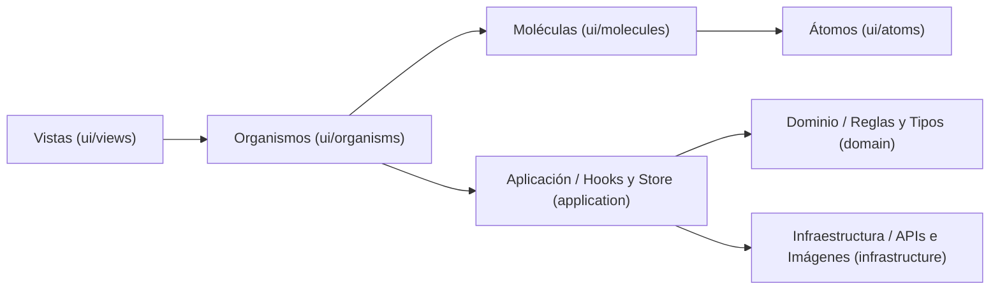

# Documentación del Módulo: Servicio a la Habitación (Room Service)

> **Para quién es esta guía:**  
> Está escrita en un lenguaje claro y práctico para que **Desarrolladores (Devs)** y **Diseñadores Gráficos (UI/UX)** hablen el mismo idioma al trabajar, diseñar o modificar pantallas de Servicio a la Habitación.

---

## 1. ¿Qué hace este módulo?

El módulo **Servicio a la Habitación** (`src/features/servicio-habitaciones/`) permite al equipo del hotel (recepción, cocina y administración) operar todo el ciclo de alimentos y servicios a la habitación desde una sola pantalla principal organizada en **4 pestañas**:

1. **Categorías** (`catalogo`): Muestra el catálogo visual de categorías del menú (ej. *Panadería y Repostería*, *Bebidas*, *Desayunos*) en formato cuadrícula o tarjetas, permite ver los productos de una categoría o crear uno nuevo desde un panel lateral.
2. **Productos** (`productos`): Catálogo completo de platillos y artículos con filtros de disponibilidad, dieta/orden, cambio entre vista **Masonry** (tarjetas escalonadas) o **Grid** (cuadrícula uniforme), vista de detalle, edición de producto y botón para agregar al carrito.
3. **Historial de Ventas** (`pedidos`): Listado y seguimiento de pedidos realizados por los huéspedes. Permite buscar, filtrar por **Prioridad**, **Canal** y **Fecha de venta**, abrir el detalle completo de cada orden y actualizar su estado en tiempo real.
4. **Nueva Categoría** (`nuevo`): Formulario para registrar nuevas categorías del menú (`POST /menu-category`), con detección automática de la **Sede**, **Sub sede** y **Edificio** donde trabaja el recepcionista que inició sesión.

Adicionalmente, un **botón flotante de carrito** (`CarritoFlotanteFab`) permanece disponible para revisar artículos acumulados, asociar la habitación/huésped hospedado y enviar la orden a cocina.

---

## 2. Cómo está organizado (Arquitectura en palabras sencillas)

El módulo combina dos ideas muy fáciles de entender:

- **Vertical Slicing (Todo en una misma caja):** Todo lo que pertenece a *Servicio a la Habitación* (pantallas, diseño, lógica, conexión con el servidor) vive junto dentro de `src/features/servicio-habitaciones/`, sin regarse por todo el proyecto.
- **Atomic Design (Construcción tipo Lego):** La interfaz gráfica (`ui/`) se arma de piezas pequeñas a pantallas completas:
  - **Átomos (`ui/atoms/`):** Piezas mínimas indivisibles (un botón, una etiqueta de color, un avatar con iniciales, un ícono animado).
  - **Moléculas (`ui/molecules/`):** Varios átomos trabajando juntos (una tarjeta de producto, una fila de tabla, una barra de filtros, un grupo de campos de formulario).
  - **Organismos (`ui/organisms/`):** Secciones completas con identidad propia (la tabla completa de historial, un modal de detalle, un panel lateral deslizante o *drawer*, un formulario completo).
  - **Vistas (`ui/views/`):** Las páginas finales que ve el usuario y que unen varios organismos.

Además, la parte no visual se divide en 3 capas para que el diseño no se mezcle con reglas de datos:



| Carpeta | Explicación para Diseñadores | Explicación para Desarrolladores |
| :--- | :--- | :--- |
| `ui/views/` | Pantallas principales donde navega el usuario. | Páginas contenedoras y enrutamiento de pestañas (`MenuServiciosHabitacionPage`). |
| `ui/organisms/` | Secciones grandes, modales, cajones laterales y formularios completos. | Componentes complejos conectados a hooks/stores; muchos cargan de forma diferida (*lazy*). |
| `ui/molecules/` | Tarjetas, filas de tabla, barras de búsqueda y bloques de campos. | Componentes reutilizables memorizados (`React.memo`) con props tipadas. |
| `ui/atoms/` | Botones, insignias (*badges*), miniaturas e íconos SVG animados. | Unidades UI puras sin estado de negocio complejo. |
| `application/` | El "cerebro" que recuerda qué hay en el carrito o qué filtros aplicaste. | Custom Hooks de React, Store global con Zustand (`carrito-store.ts`) y `lazyWithFallback`. |
| `domain/` | Las reglas del hotel: colores de cada estado, formato de moneda y validaciones. | Interfaces TypeScript, constantes de negocio y funciones puras sin efectos secundarios. |
| `infrastructure/` | La mensajería con el servidor y el optimizador automático de fotos. | Repositorios Axios con `executeBalancedRequest`, `validateStatusCode`, caché LRU y downscaler. |

---

## 3. Guía Visual y de Diseño (Para Diseñadores Gráficos)

### 3.1 Tipografía y Tokens de Color Base

En `src/index.css` se definen las variables globales que dan personalidad cálida y editorial a Nexora:

- **Tipografía principal (`--font-sans`):** `'Poppins', system-ui, 'Segoe UI', Roboto, sans-serif` (incluye explícitamente el Historial de Ventas, tarjetas y formularios).
- **Colores de marca (`@theme`):**
  - `--color-primary`: `#5a311f` (café espresso principal, botones y acentos de marca)
  - `--color-secondary`: `#67543e` (café medio secundario)
  - `--color-neutral`: `#6d6e76` (grises neutros para textos de apoyo)
  - `--color-surface`: `#d4c7b7` (superficies suaves / bordes cálidos)
  - `--color-danger`: `#9c3b31` (alertas y errores críticos)
- **Superficies en Modo Claro (`:root` / `[data-theme='light']`):**
  - Fondo general (`--nx-canvas`): `#f6f1e8`
  - Paneles y tarjetas (`--nx-panel`): `#fffdf8`
  - Líneas y divisores (`--nx-line`): `#e6dccd`
  - Texto principal (`--nx-ink`): `#2c2118`
  - Texto secundario (`--nx-ink-muted`): `#7d6f5d`
- **Superficies en Modo Oscuro (`.dark` / `[data-theme='dark']`):**
  - Fondo general (`--nx-canvas`): `#16110b`
  - Paneles (`--nx-panel`): `#211a12`
  - Líneas (`--nx-line`): `#35291c`
  - Texto principal (`--nx-ink`): `#f0e8da`

---

### 3.2 Paleta de los 10 Estados de Pedido (Historial y Detalle)

Para que el recepcionista identifique el estado de una orden a simple vista, **cada estado tiene un nombre claro en español, un color hexadecimal único y un ícono único de FontAwesome** definidos en `domain/service-request-status.ts`:

| Código en Servidor | Etiqueta Visible | Descripción | Color Hex | Ícono FontAwesome |
| :--- | :--- | :--- | :--- | :--- |
| `pending` | **En cola** | Pedido en cola de espera | `#1E3A8A` | `faClock` |
| `confirmed` | **Confirmado** | Pedido recibido en cocina | `#A7C957` | `faCircleCheck` |
| `in_preparation` | **En preparación** | Pedido en preparación en cocina | `#0B132B` | `faFire` |
| `in_transit` | **En tránsito** | Pedido en tránsito hacia la habitación | `#006D77` | `faTruckFast` |
| `delivering` | **Entregando** | Pedido siendo entregado al huésped | `#1B4332` | `faBellConcierge` |
| `on_the_way` | **En camino** | Pedido en camino a la habitación | `#4B0082` | `faRoute` |
| `delivered` | **Entregado** | Pedido entregado al huésped | `#3D4D22` | `faHandshake` |
| `canceled` | **Cancelado** | Pedido cancelado | `#FF6B6B` | `faCircleXmark` |
| `cancelled` | **Anulado** | Pedido anulado | `#FF8C00` | `faTriangleExclamation` |
| `rejected` | **Rechazado** | Pedido rechazado | `#B20000` | `faBan` |

> **Nota para Diseño:** Al elegir un color de fondo o borde para el badge de categoría (`PedidoCategoriaEstadoBadge`), el componente aplica el hex correspondiente al 10%–15% de opacidad en modo claro y variantes contrastadas en modo oscuro para garantizar lectura cómoda.

---

### 3.3 Comportamiento Responsivo (Móvil, Tablet/iPad y Escritorio)

1. **Historial de Ventas (`PedidosHistorialTabla.tsx` y `PedidosTablaSkeleton.tsx`):**
   - **Móvil, Tablet e iPad (`< 1280px` / menor a `xl`):** La tabla se transforma automáticamente en **tarjetas** (`PedidoTablaMobileCard.tsx`). En móvil se muestra en 1 columna y desde `sm` (`>= 640px`) en **2 columnas (`sm:grid-cols-2`)**, con avatar de iniciales del huésped, badge de estado, **Fecha de venta**, total y botón `Ver detalle`.
   - **Escritorio (`>= 1280px` / `xl:`):** Se muestra la **tabla tradicional** (`PedidoTablaRow.tsx`) con vista tabular y scroll infinito (`InfiniteScroll`).
2. **Catálogo de Categorías y Productos (`use-responsive-columns.ts`):**
   - `< 640px` (móvil): **1 columna**
   - `>= 640px` (`sm`): **2 columnas**
   - `>= 1024px` (`lg`): **3 columnas**
   - `>= 1280px` (`xl`): **4 columnas**

---

### 3.4 Reglas de Imágenes y Micro-interacciones

- **Tamaños óptimos automáticos:** Ninguna foto se renderiza a resolución gigante innecesaria. El balanceador de imágenes (`image-load-balancer.ts` + `image-downscaler.ts`) reduce en el navegador usando `OffscreenCanvas` (cuando está disponible) a:
  - **`160px`** para miniaturas en filas y modales (`PedidoProductoThumbnail`, `CategoriaProductoFilaItem`).
  - **`640px`** para tarjetas del catálogo.
  - **Caché LRU (`image-cache-lru.ts`):** Guarda hasta **50 imágenes** en memoria y limita descargas simultáneas a **3** para que las tarjetas carguen rápido sin congelar el navegador.
- **Sin desenfoques pesados en listas:** En modales y tarjetas con desplazamiento largo se evita `backdrop-blur` excesivo sobre contenedores grandes para mantener fluidez en tablets y computadoras de recepción.
- **Íconos SVG animados propios:** El módulo cuenta con ilustraciones interactivas ligeras (`CampanaHotelAnimada`, `PlatoAlimentosAnimado`, `CarritoSupermercadoAnimado`, `BasuraAbiertaAnimada`, `TicketImpresoraAnimado`, `CubiertosRozandoAnimados`, `HotelEdificioAnimado`, `IconoEscribirAnimado`, `MartilloJuezAnimado`) y usa el componente compartido `Rocket` cuando se envía o actualiza información importante.

---

## 4. Mapa de Componentes (Qué hace y cómo trabaja cada pieza)

### 4.1 Vistas (`ui/views/`)

| Archivo | Qué hace |
| :--- | :--- |
| `ServicioHabitacionesPage.tsx` | Punto de entrada principal; envuelve y renderiza `MenuServiciosHabitacionPage`. |
| `MenuServiciosHabitacionPage.tsx` | Orquesta las 4 pestañas (`Categorías`, `Productos`, `Historial de Ventas`, `Nueva Categoría`), el botón flotante de carrito (`CarritoFlotanteFab`) y los drawers perezosos (`AgregarProductoDrawer`, `RegistrarCategoriaDrawer`, `CarritoProductosDrawer`). |
| `AgregarProductoPage.tsx` | Vista independiente de página completa para registrar un producto (`FormularioAgregarProductoCard`). |

---

### 4.2 Organismos (`ui/organisms/`)

| Organismo | Función y Componentes que coordina |
| :--- | :--- |
| `MenuCategoriasGrid.tsx` | Muestra todas las categorías del menú. Coordina `MenuCategoriasToolbar`, `ImageBalancerStatusBanner`, `MenuCategoriasContenido` y `MenuCategoriasModalesHost`. |
| `MenuCategoriaModalProductos.tsx` | Modal que abre los productos filtrados de una categoría específica; incluye buscador, carga con `Loading` perezoso, banner del balanceador y lista `MenuCategoriaModalProductosLista`. |
| `ItemMenuProductosMasonry.tsx` | Catálogo completo de productos con barra de filtros (`ProductosMasonryNavbar`), switch de vista (`ProductosVisualizacionNavbar`), grid/masonry (`ProductosCatalogoGrid`), estado vacío (`ItemMenuProductosEmptyState`) y drawers de detalle/edición/creación. |
| `PedidosServicioHabitacionOrganism.tsx` | Pantalla completa del **Historial de Ventas**. Conecta el hook `usePedidosServicioHabitacion` con `PedidosControlToolbar`, `PedidosFeedbackBanner` (`PlanetAlert`), `PedidosHistorialTabla` (con esqueleto `PedidosTablaSkeleton`), `PedidosEmptyState` y `PedidoDetalleModal` (cargado con `lazyWithFallback`). |
| `PedidoDetalleModal.tsx` | Modal al hacer clic en `Ver detalle` de una venta. Muestra `PedidoDetalleModalHeader`, buscador interno de productos, tarjeta del huésped (`PedidoDetalleHuespedCard`), lista virtualizada (`VirtualizedCardSlot` + `PedidoDetalleProductoCard`), pie de cambio de estado (`PedidoDetalleModalFooter`) y overlay `PedidoEstadoGuardadoOverlay` (`Rocket`). |
| `FormularioServicioHabitacionCard.tsx` | Tarjeta completa para crear una categoría (`POST /menu-category`). Integra `CampanaHotelAnimada`, `ServicioHabitacionCamposGrid`, `SeccionCargaImagen`, alerta de validación (`StatusCodeAlert`), `Loading` al detectar ubicación y `ServicioHabitacionGuardadoOverlay`. Expone `onCategoriaGuardada` para refrescar el catálogo automáticamente. |
| `RegistrarCategoriaDrawer.tsx` | Versión en panel lateral deslizante (*Drawer*) de creación de categoría; reutiliza los mismos bloques visuales (`CampanaHotelAnimada`, `ServicioHabitacionCamposGrid`, `SeccionCargaImagen`, `ServicioHabitacionGuardadoOverlay`). |
| `FormularioAgregarProductoCard.tsx` | Tarjeta para registrar un nuevo producto (`POST /item-menu`). Agrupa `PlatoAlimentosAnimado`, `ProductoCategoriaField`, `ProductoPreciosYNombreFields`, `ProductoHorarioYDietaFields`, `SeccionCargaImagen`, `PlanetAlert` y `ProductoGuardadoOverlay`. |
| `AgregarProductoDrawer.tsx` | Versión en panel lateral deslizante (*Drawer*) para crear productos sin salir de la pantalla actual, preseleccionando la categoría si se abre desde una tarjeta. |
| `EditarProductoDrawer.tsx` | Panel lateral deslizante para modificar un producto existente (`EditarProductoFormFields`), con feedback de estado (`StatusCodeAlert`) y animación `Rocket` al guardar. |
| `CarritoProductosDrawer.tsx` | Panel lateral del carrito conectado a Zustand (`useCarritoStore`); permite editar cantidades, eliminar platillos, vaciar carrito y abrir `ModalConfirmarPedidoCocina`. |
| `CarritoProductosModal.tsx` | Variante en modal clásico centrado del resumen del carrito (subtotales, impuestos, total y acceso al envío). |
| `CarritoServicioHabitacionOrganism.tsx` | Vista ampliada del carrito con configuración de canal, método de pago y envío a cocina (`ModalConfirmarPedidoCocina`). |

---

### 4.3 Moléculas (`ui/molecules/`)

Agrupadas por área funcional para ubicarlas rápidamente:

- **Catálogo de Categorías:**
  - `MenuCategoriasToolbar.tsx`: Barra superior con búsqueda, ordenamiento, creación de categoría y recarga.
  - `MenuCategoriasContenido.tsx`: Decide entre vista Masonry (`CategoriasMasonryColumnsLayout`) o cuadrícula (`CategoriasCatalogoGrid`) y estado vacío (`MenuCategoriasEmptyState`).
  - `MenuCategoriaCard.tsx`: Tarjeta individual de categoría con imagen optimizada y acciones.
  - `MenuCategoriaModalDetalle.tsx`, `MenuCategoriaModalProductosLista.tsx`, `CategoriaProductoFilaItem.tsx`, `CategoriaProductoSelector.tsx`, `ItemMenuCategoriaServicioCard.tsx`: Componentes de detalle y filas de productos dentro de una categoría.
  - `MenuCategoriasModalesHost.tsx`: Centraliza la apertura de modales y drawers desde el listado de categorías.

- **Catálogo de Productos:**
  - `ProductosMasonryNavbar.tsx` y `ProductosVisualizacionNavbar.tsx`: Filtros de disponibilidad/dieta/orden y selector Masonry vs Grid.
  - `ProductosCatalogoGrid.tsx` y `ProductosMasonryColumnsLayout.tsx`: Distribuyen tarjetas (`ItemMenuProductoCard` o `ItemMenuProductoMasonryCard` + `ItemMenuProductoMasonryOverlay`).
  - `ItemMenuProductoModalDetalle.tsx`: Modal con información nutricional, horario, precio e imagen ampliada del producto.
  - `ItemMenuProductosEmptyState.tsx` e `ImageBalancerStatusBanner.tsx`: Estado vacío y barra discreta de estado cuando el balanceador está optimizando múltiples fotos.

- **Historial de Ventas, Comandas y Detalle:**
  - `PedidosControlToolbar.tsx`: Buscador, selector de **Prioridad**, selector de **Canal**, filtro de **Fecha de venta** (`LazyDatePicker` con `React.lazy`) y botón actualizar.
  - `PedidosFeedbackBanner.tsx`: Aviso visual (`PlanetAlert`) cuando falla o responde el servidor.
  - `PedidosTablaSkeleton.tsx`: Esqueleto de carga responsivo (tarjetas en `< xl`, filas en `>= xl`).
  - `PedidosHistorialTabla.tsx`: Contenedor que muestra tarjetas en móvil/tablet/iPad (`< xl`) y tabla en escritorio (`>= xl`) con `InfiniteScroll`.
  - `PedidoTablaRow.tsx`: Fila de la tabla en escritorio (`Huésped` con iniciales, `Categoría / Estado`, `Fecha de venta`, `Precio a pagar`, botón `Ver detalle`).
  - `PedidoTablaMobileCard.tsx`: Tarjeta responsiva para móvil, tablet y iPad (`< xl`).
  - `PedidosEmptyState.tsx`: Pantalla cuando no hay pedidos o ningún pedido coincide con los filtros.
  - `PedidoDetalleModalHeader.tsx`: Encabezado del modal de detalle (categoría, número de orden y total de artículos).
  - `PedidoDetalleHuespedCard.tsx`: Tarjeta con el nombre, iniciales y habitación del huésped.
  - `PedidoDetalleProductoCard.tsx`: Tarjeta de cada producto pedido (miniatura `160px`, nombre, precio unitario, cantidad, nota para cocina y total del ítem).
  - `PedidoDetalleModalFooter.tsx`: Muestra el total a pagar, el dropdown **Cambiar estado** (con los 10 estados e íconos) y el botón `Guardar estado`.
  - `PedidoEstadoGuardadoOverlay.tsx`: Pantalla animada (`Rocket`) mientras se envía el cambio de estado.
  - `PedidoServicioHabitacionCard.tsx`: Tarjeta tipo comanda (KDS) con prioridad, acordeón de productos y cambio rápido de estado.

- **Formularios (Categorías y Productos) y Carrito:**
  - `ServicioHabitacionCamposGrid.tsx`: Campos del formulario de categoría (`Código de orden`, `Sede`, `Sub sede`, `Edificio` bloqueados por defecto cuando se autodetectan + botón `UbicacionManualToggleButton`, `Nombre de la categoría` y `Descripción`), con resaltado de errores por campo.
  - `ServicioHabitacionGuardadoOverlay.tsx`: Overlay animado (`Rocket`) durante el registro de categoría (`Registrando Categoría / Guardando la nueva categoría del menú`).
  - `ProductoCategoriaField.tsx`, `ProductoPreciosYNombreFields.tsx`, `ProductoHorarioYDietaFields.tsx`, `EditarProductoFormFields.tsx`, `ProductoGuardadoOverlay.tsx`: Bloques de campos y feedback para crear o editar platillos.
  - `SeccionCargaImagen.tsx`: Une `ImagenDropzone` e `ImagenPreviewMiniatura` para seleccionar, previsualizar o quitar fotos antes de subirlas a Supabase Storage.
  - `CarritoModalItemRow.tsx`, `ModalConfirmarPedidoCocina.tsx`, `ModalSeleccionarRecepcion.tsx`, `RecepcionEstanciaCard.tsx`, `ModalFallaHuesped.tsx`: Flujo de revisión del carrito, búsqueda de huésped hospedado (`/stays`) y confirmación de pedido (`POST /service-request`).

---

### 4.4 Átomos (`ui/atoms/`)

| Átomo | Propósito |
| :--- | :--- |
| `PedidoGuestInitialsAvatar.tsx` | Muestra las **iniciales del huésped** en un avatar estilizado en lugar de un ícono genérico. |
| `PedidoCategoriaEstadoBadge.tsx` | Píldora visual con el nombre de la categoría/estado y su color + ícono único FontAwesome. |
| `PedidoProductoThumbnail.tsx` | Miniatura optimizada a `160px` mediante `useBalancedProductImage` con respaldo visual elegante si falta la foto. |
| `UbicacionManualToggleButton.tsx` | Botón con ícono FontAwesome (`faPenToSquare` / `faLocationCrosshairs`) que alterna entre **Cambiar ubicación** (manual) y **Usar mi ubicación** (automática por sesión). |
| `VirtualizedCardSlot.tsx` | Envuelve tarjetas largas usando `IntersectionObserver` (`rootMargin: '800px'`) para renderizar solo lo cercano a la pantalla. |
| `CarritoFlotanteFab.tsx` | Botón flotante con contador de productos agregados al carrito. |
| `ImagenDropzone.tsx` y `ImagenPreviewMiniatura.tsx` | Zona de arrastrar/soltar imagen y miniatura de vista previa en formularios. |
| `LayoutViewSwitch.tsx` y `Switch.tsx` | Interruptores visuales para cambiar vista (`masonry` / `grid`) o toggles booleanos (vegetariano, vegano, disponible). |
| `ProductoDisponibilidadBadge.tsx`, `CategoriaVinculadaBadge.tsx`, `ProductoImagenHeader.tsx`, `ProductoCardAccionesFooter.tsx` | Piezas atómicas que componen las tarjetas del catálogo de productos. |
| **Átomos SVG Animados:** `CampanaHotelAnimada.tsx`, `PlatoAlimentosAnimado.tsx`, `CarritoSupermercadoAnimado.tsx`, `BasuraAbiertaAnimada.tsx`, `TicketImpresoraAnimado.tsx`, `CubiertosRozandoAnimados.tsx`, `HotelEdificioAnimado.tsx`, `IconoEscribirAnimado.tsx`, `MartilloJuezAnimado.tsx` | Ilustraciones vectoriales con animaciones suaves en `motion/react` para dar vida y claridad a cabeceras, botones y estados vacíos. |

---

## 5. Flujos Principales Paso a Paso

### 5.1 Autodetección de Ubicación del Recepcionista y Registro de Categoría
1. Al abrir **Nueva Categoría** (`FormularioServicioHabitacionCard.tsx`), el hook `useUbicacionRecepcionista` lee el usuario logueado en `localStorage.getItem('auth_user')` y extrae su `headquarters_id`.
2. Mientras consulta el servidor, aparece el componente compartido `/shared/loading` (`Loading`).
3. El repositorio `api-formulario-servicio-repository.ts` ejecuta 3 peticiones balanceadas con `executeBalancedRequest` y validadas con `validateStatusCode`:
   - `GET /headquarters/{id}` → Obtiene la **Sede** actual.
   - `GET /sub-headquarters/by-headquarter/{id_headquarters}` → Obtiene las **Sub sedes** asociadas.
   - `GET /building?headquarters_id={id_headquarters}` → Obtiene los **Edificios** asociados.
4. Con la ubicación detectada, los selectores **Sede**, **Sub sede** y **Edificio** se rellenan automáticamente y permanecen bloqueados (`isDisabled`) para evitar errores de captura.
5. Si el recepcionista cubre otro edificio o desea elegir manualmente, presiona **`Cambiar ubicación`** (`UbicacionManualToggleButton`), lo cual desbloquea los selectores y carga el catálogo completo (`GET /headquarters`, etc.). Con un clic en **`Usar mi ubicación`**, vuelve al modo automático.
6. Al guardar:
   - Se validan los campos obligatorios con `validateFormularioServicioFields`; si falta alguno, se marca el campo en rojo, se enfoca el input faltante y se hace scroll suave hacia la alerta (`StatusCodeAlert`).
   - Si se adjuntó imagen, se sube a Supabase Storage (si falla, se avisa al usuario en lugar de fallar en silencio).
   - Se envía `POST /menu-category` mostrando `ServicioHabitacionGuardadoOverlay` (`Rocket`) y se ejecuta `onCategoriaGuardada` para actualizar la lista.

---

### 5.2 Historial de Ventas y Cambio de Estado de un Pedido
1. `usePedidosServicioHabitacion` solicita `GET /service-request` y en paralelo resuelve nombres de huéspedes (`/person/{id}` o `/persons/{id}`), productos (`/item-menu`) y categorías (`/menu-category`) mediante `pedidos-metadatos-resolver.ts`.
2. El recepcionista puede filtrar por texto (nombre del huésped, habitación, código o platillo), **Prioridad**, **Canal** y **Fecha de venta** (`LazyDatePicker`).
3. En pantallas `< 1280px` ve tarjetas cómodas en 1 o 2 columnas; en escritorio `>= 1280px` ve la tabla completa.
4. Al presionar **`Ver detalle`**, se abre `PedidoDetalleModal` mostrando los datos del huésped, la lista virtualizada de productos y el resumen de pago.
5. En el pie del modal (`PedidoDetalleModalFooter`), el selector **`Cambiar estado`** permite escoger cualquiera de los **10 estados permitidos por el backend**.
6. Al presionar **`Guardar estado`**, se muestra el overlay `Rocket` (`PedidoEstadoGuardadoOverlay`) y se envía `PUT /service-requests/{id}` (usando `executeBalancedRequest` + `validateStatusCode`), actualizando la orden en memoria sin recargar toda la página.

---

### 5.3 Carrito y Envío de Nuevo Pedido
1. Desde **Productos** (`ItemMenuProductosMasonry`), el recepcionista añade platillos al carrito (`useCarritoStore` en Zustand, con índice `cantidadPorKey` para actualizar contadores instantáneamente).
2. Abre el carrito desde `CarritoFlotanteFab` (`CarritoProductosDrawer` o `CarritoServicioHabitacionOrganism`), ajusta cantidades o agrega notas especiales para cocina.
3. En `ModalConfirmarPedidoCocina` selecciona la estadía/huésped activo (consultando `/stays` y `/persons`), define canal y método de pago, y envía `POST /service-request` con animación `Rocket`.

---

## 6. Guía Técnica para Desarrolladores

### 6.1 Puntos de Entrada y Reutilización
- Importa siempre lo público desde `src/features/servicio-habitaciones/index.ts` para respetar el aislamiento del slice.
- Para nuevas importaciones diferidas de componentes con exportación nombrada, usa el helper compartido:
  ```ts
  import { lazyWithFallback } from '../../application/lazy-with-fallback'
  ```
  Así garantizas carga perezosa (`React.lazy`) protegida con `try/catch` y componente de respaldo seguro si falla la red.

### 6.2 Reglas de Red y Resiliencia Obligatorias
Toda petición al backend en `infrastructure/` debe pasar por:
1. **`executeBalancedRequest`** (`src/features/reservas/infrastructure/api-load-balancer.ts`): balancea la carga y gestiona reintentos controlados.
2. **`validateStatusCode`** (`src/shared/lib/status-code-validator.ts`): traduce códigos HTTP a mensajes comprensibles para el usuario (`StatusCodeAlert` o `PlanetAlert`).
3. **`try / catch` explícito**: nunca dejes promesas sin capturar ni errores técnicos crudos visibles en UI.

### 6.3 Convenciones de Mantenimiento (Para Devs y Diseñadores)
- **Si un componente supera ~250–350 líneas:** divide piezas en `ui/atoms/` o `ui/molecules/` respetando Atomic Design.
- **Si necesitas cambiar colores o íconos de estado:** edita únicamente `SERVICE_REQUEST_STATUS_CONFIG` en `domain/service-request-status.ts`; tanto los badges de la tabla/tarjetas como el dropdown del modal heredan esa única fuente de verdad.
- **Si cambias tipografía o colores base de marca:** hazlo en `src/index.css` / `src/design-tokens/colors.ts` para mantener coherencia en todo Nexora.
- **No expongas rutas de API ni jerga de servidor al recepcionista:** los mensajes visibles (`Loading`, alertas, botones, tooltips) deben estar siempre en español claro orientado a la operación del hotel.
